<div align="center">

<a href="https://sky.obelisk.ar"></a>


<p>
  <a href="https://sky.obelisk.ar"></a>
  <a href="https://github.com/obelisk-app/obelisk-sky/stargazers"></a>
  <a href="https://github.com/obelisk-app/obelisk-sky/commits/main"></a>
  <a href="https://github.com/obelisk-app/obelisk-sky/graphs/commit-activity"></a>
</p>
<p>
  
  
  
  
  
  
  
</p>

<h3>
  <a href="https://sky.obelisk.ar/app">🏝️ Enter the island</a>
  &nbsp;·&nbsp;
  <a href="https://sky.obelisk.ar">🌐 Landing page</a>
  &nbsp;·&nbsp;
  <a href="https://obelisk.ar">🗿 What is Obelisk?</a>
  &nbsp;·&nbsp;
  <a href="#-run-it-yourself">🛠️ Run it yourself</a>
</h3>

</div>

**Obelisk Sky** is a 3D floating-island village that is also a real [Obelisk](https://obelisk.ar) client. Every [NIP-29](https://github.com/nostr-protocol/nips/blob/master/29.md) channel on a relay is a house. When someone posts, their character walks to that channel's house. When they reply to someone, they walk over to them. People sit down for mate, train in the park, join voice calls and play games, all live, all on Nostr.

You log in with your own Nostr key. The server holds no keys and never talks to a relay: everything happens in your browser.

<div align="center">
  <a href="https://sky.obelisk.ar/app">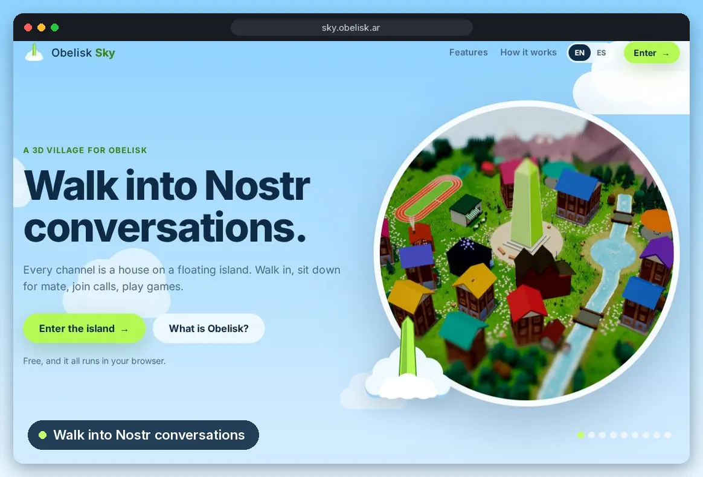</a>
</div>


## 🏘️ How it works

<div align="center">
  
</div>

<table>
<tr>
<td width="33%" valign="top">

### 1 · Log in with Nostr
A browser extension (NIP-07), a remote signer (NIP-46, by QR or bunker URI), a brand-new key made on your device, or a pasted key. No account to sign up for.

</td>
<td width="33%" valign="top">

### 2 · Pick a relay
`public.obelisk.ar` or **any NIP-29 relay**. Each community gets its own island, laid out from its own channels.

</td>
<td width="33%" valign="top">

### 3 · Walk in
Find a house and say hi. Busier channel, bigger house. Not admitted yet? You land on the **guest island**, a scripted village that only lives in your browser.

</td>
</tr>
</table>


## ✨ A chat you can walk around in

<table>
<tr>
<td width="50%">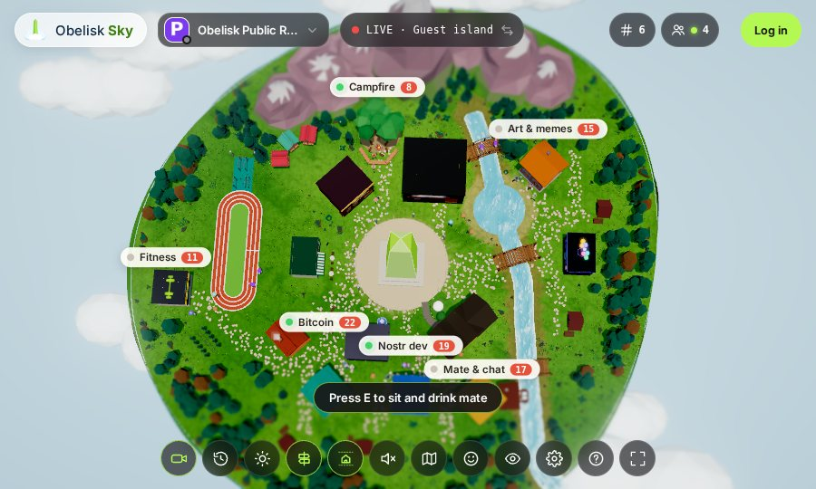</td>
<td width="50%">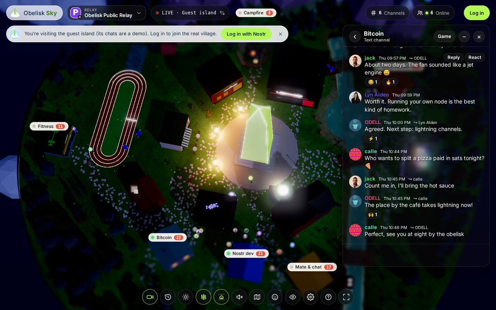</td>
</tr>
<tr>
<td><b>Every channel is a house.</b> Signs float over each one with how many people are talking. Click one to walk there.</td>
<td><b>A real Obelisk client.</b> Replies, reactions, mentions, emoji, GIFs, stickers, voice notes and forums, rendered with obelisk-dex's own components.</td>
</tr>
<tr>
<td>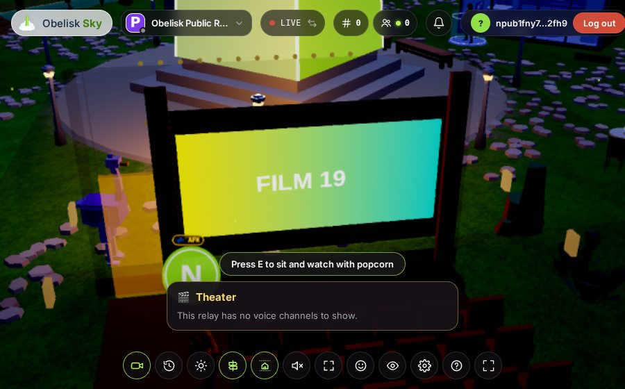</td>
<td>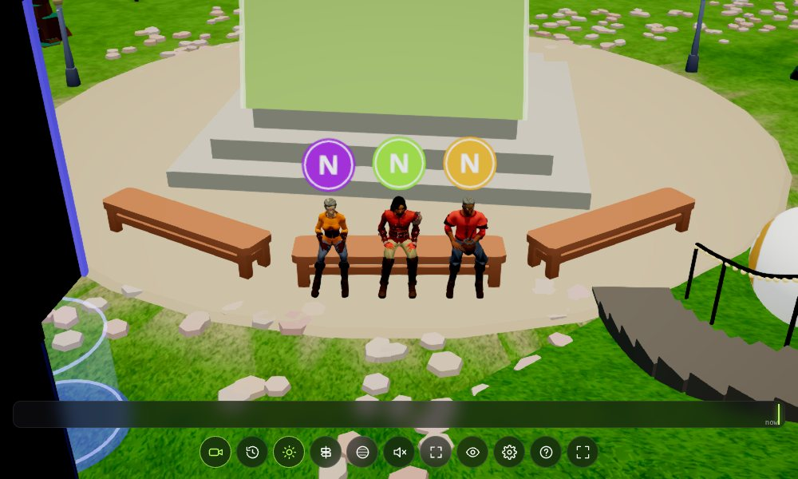</td>
</tr>
<tr>
<td><b>Voice calls and the theater.</b> Join a call from a voice channel's pavilion; a shared screen plays on the theater's big wall.</td>
<td><b>Mate, café, parrilla.</b> Sit on a bench and the mate goes round. Coffee and a laptop at the café, asado at the parrilla.</td>
</tr>
<tr>
<td>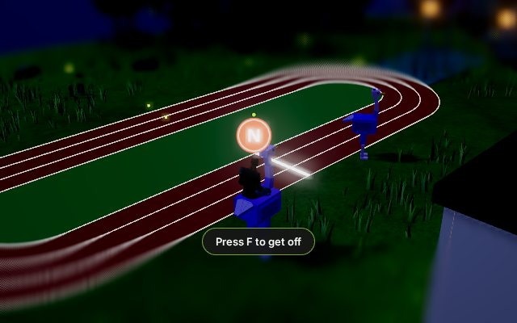</td>
<td>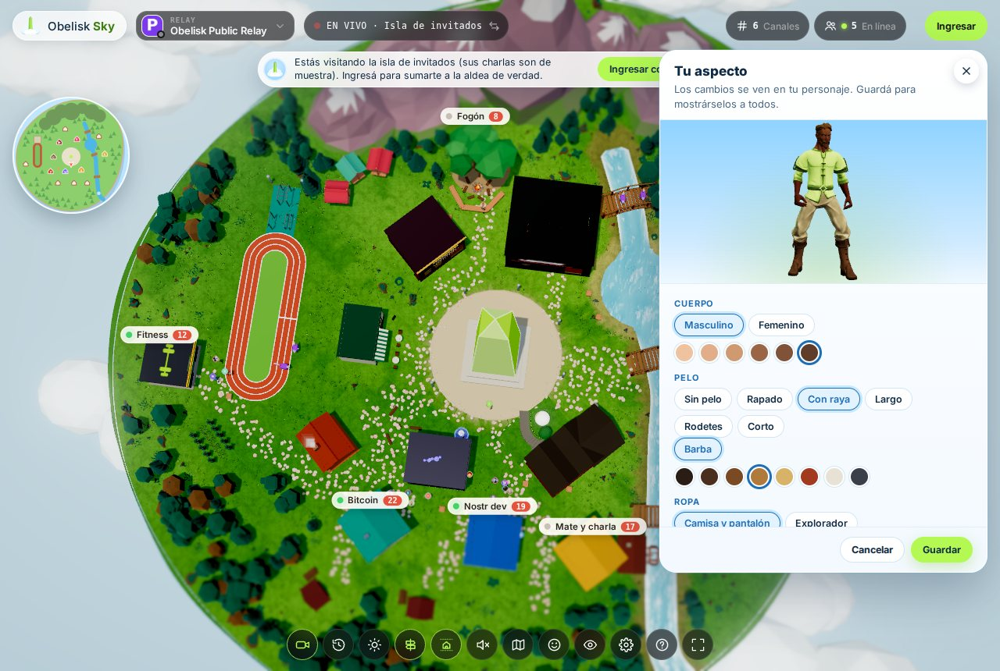</td>
</tr>
<tr>
<td><b>Ride a nostrich.</b> Walk up to one (they run from runners), press <kbd>F</kbd> and gallop the running track.</td>
<td><b>Your own look.</b> Body, outfit, hair, colours and a pet, signed and published on Nostr, so everyone in the village sees you the same way.</td>
</tr>
<tr>
<td>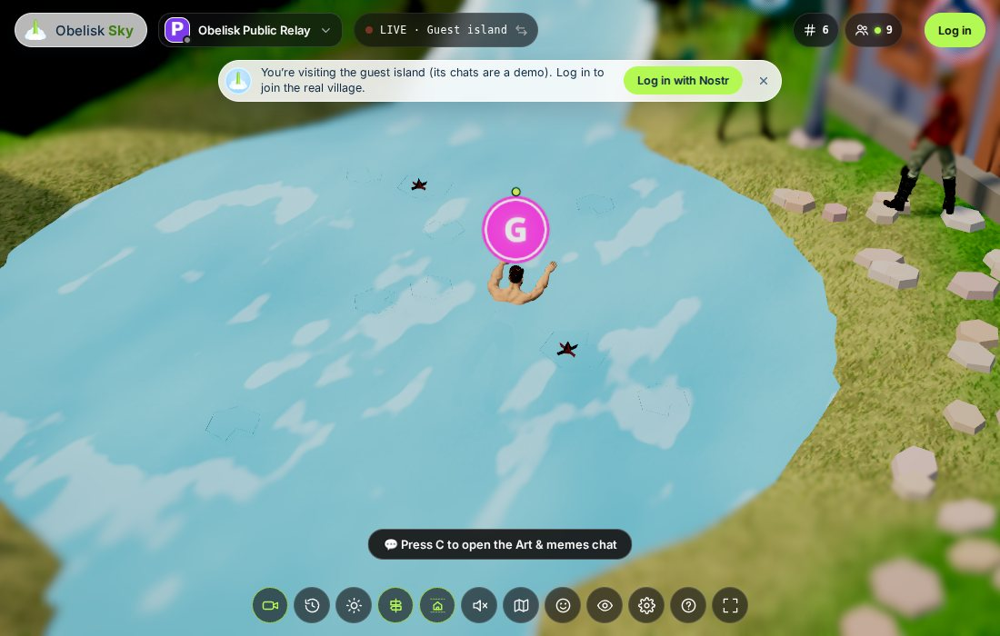</td>
<td>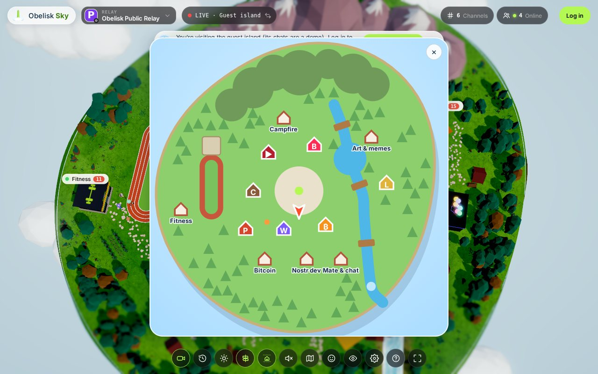</td>
</tr>
<tr>
<td><b>Swim the river and the pond</b>, under the bridges, with a breaststroke.</td>
<td><b>A minimap.</b> Press <kbd>N</kbd>, open it big and pick a house to walk to.</td>
</tr>
<tr>
<td>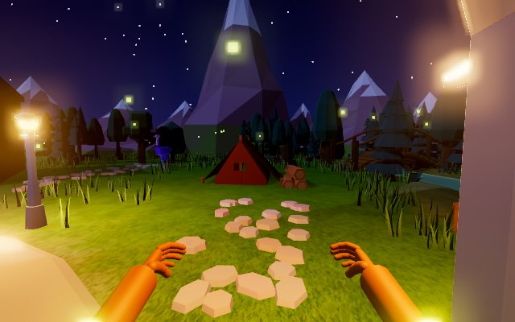</td>
<td>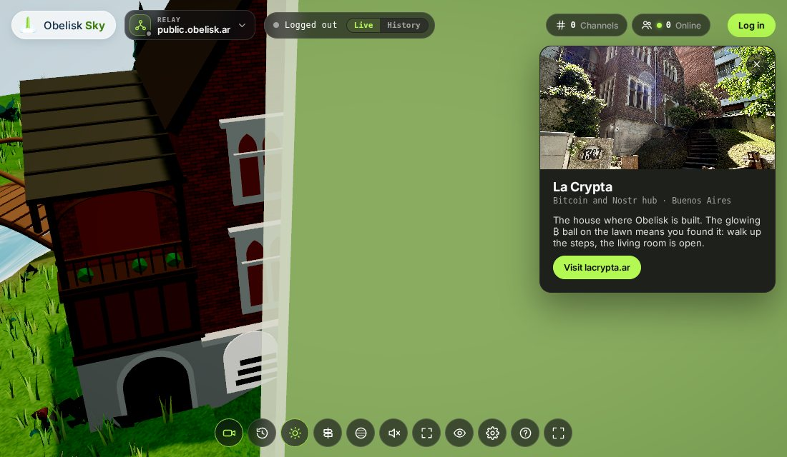</td>
</tr>
<tr>
<td><b>First person.</b> Press <kbd>V</kbd> and look around through your own eyes, hands and all.</td>
<td><b>Landmarks from Buenos Aires.</b> La Crypta, the nostr-wot HQ, the café, the parrilla, Liberture's house, the theater, and LABITCONF with La Bitcoineta parked inside.</td>
</tr>
</table>

### …and also

| | | |
|---|---|---|
| ⚡ **Zaps** fly from sender to recipient and burst into coins | 🏋️ **Calisthenics park**: pull-ups, dips, push-ups, muscle-ups | 🎲 **Games**: Chain Reaction, played on Nostr |
| 💃 **Emotes** on <kbd>G</kbd>: dance, lotus, nod, fold your arms… | 🌗 **Time of day**: from a sunny plaza to a starry night | 💬 **DMs** by walking up to someone |
| 🗺️ **Forums** nested in the channel list, opened in place | 🇦🇷 **English and Spanish** (`?lang=es`) | 📱 **Phones**: thumb stick, tap to walk, pinch to zoom |

<details>
<summary><b>📱 On a phone</b></summary>
<br>
<div align="center">
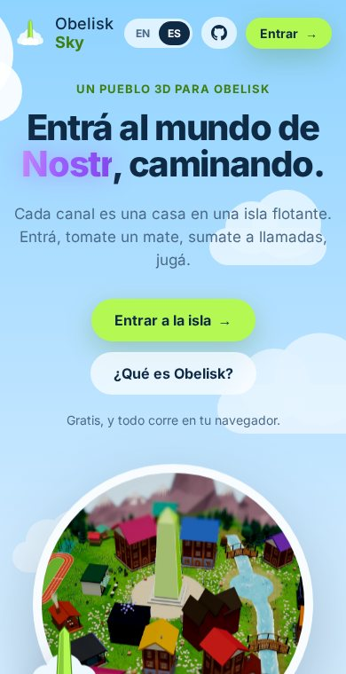&nbsp;
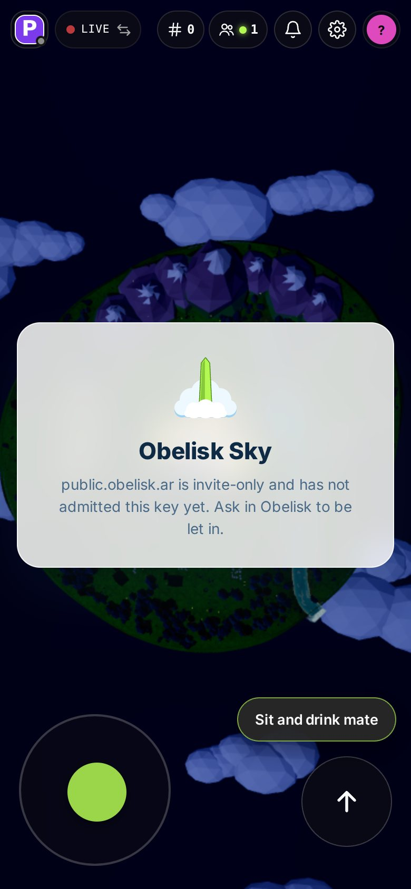&nbsp;
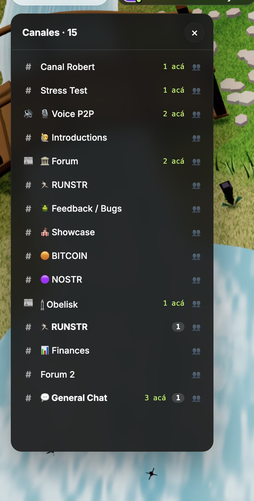&nbsp;
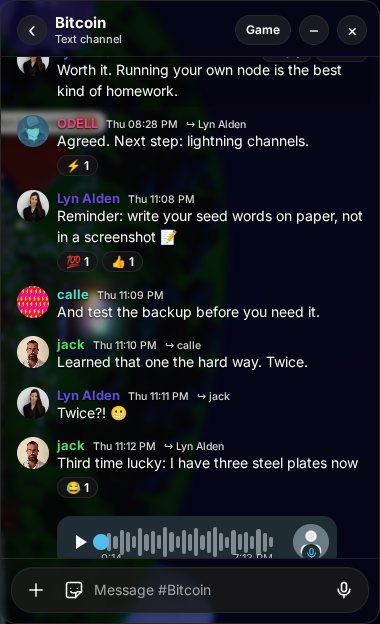
</div>
</details>

<details>
<summary><b>⌨️ Controls</b></summary>
<br>

| Key | What it does |
|---|---|
| <kbd>W</kbd> <kbd>A</kbd> <kbd>S</kbd> <kbd>D</kbd> | Walk (arrow keys work too) |
| <kbd>Shift</kbd> or double-tap a direction | Run |
| <kbd>Space</kbd> | Jump; hold it to keep jumping |
| Click / drag / scroll | Walk there / turn the camera / zoom |
| <kbd>Enter</kbd> | Type in the channel you're in |
| Click a speech bubble | Reply, and walk over to them |
| <kbd>E</kbd> | Sit and drink mate, have a coffee, eat asado; train at a bar in the park |
| <kbd>F</kbd> | Ride a nostrich (and get off again) |
| <kbd>G</kbd> then <kbd>1</kbd>–<kbd>9</kbd> | Emotes |
| <kbd>V</kbd> | First-person view (<kbd>V</kbd> or <kbd>Esc</kbd> to leave) |
| <kbd>N</kbd> | Minimap |

On a phone: thumb stick bottom left (push all the way to run), tap to walk, drag to turn, pinch to zoom.
</details>


## 🔐 Your key, your browser

```
 ┌──────────────── your browser ────────────────┐
 │  signer (NIP-07 / NIP-46 / local key)         │
 │  RelayHub ── NIP-29 relay(s) ── live feed      │      ┌──── server (tiny Node) ────┐
 │  three.js world · chat · calls · games        │ ───▶ │  static files               │
 └───────────────────────────────────────────────┘      │  /api/link-preview          │
                                                         │  /api/avatar                │
                                                         │  no keys · no relay access  │
                                                         └─────────────────────────────┘
```

The server only serves the page, unfurls links and proxies profile pictures that lack CORS (raster images only, with SSRF guards). It never holds a key and never opens a relay connection. Signing, reading and publishing all happen client-side.

## 🛠️ Run it yourself

```bash
git clone https://github.com/obelisk-app/obelisk-sky.git
cd obelisk-sky
npm install
npm run dev:client          # the village on Vite's dev server
```

| Command | |
|---|---|
| `npx tsc -p tsconfig.json` | Typecheck (`vite build` doesn't) |
| `npm test` | Vitest, with jsdom for the React islands |
| `npm run build` | Client to `dist/client`, server to `dist/server.js` |
| `npm start` | Serve the build: the landing page at `/`, the village at `/app` |
| `npm run vendor` | Re-snapshot obelisk-dex's source into `vendor/obelisk` |

Agents and humans start at [`AGENTS.md`](AGENTS.md): the stack, the layout, the seam with obelisk-dex and the world rules that are easy to break. [`docs/ROADMAP.md`](docs/ROADMAP.md) lists the obelisk-dex features still to port.

<details>
<summary><b>🗂️ Where things live</b></summary>

```
client/
  index.html        the landing page at /
  app/index.html    the village at /app
  src/world/        the 3D world: island, houses, people, landmarks, water, zaps, emotes
  src/nostr/        hub, session, feed, publish, profiles, live calls, movement
  src/chat/         obelisk-dex's message components and message bar, as React islands
  src/guest/        the guest island: scripted villagers and threads, local only
  src/ui/           panels: chat, channels, DMs, settings, minimap, look creator…
server/             static server, link preview, avatar proxy
vendor/obelisk/     pinned snapshot of obelisk-dex, aliased as @/
```
</details>


## 🌐 The Obelisk family

| | |
|---|---|
| 🗿 [**obelisk**](https://github.com/obelisk-app/obelisk) | Nostr-native chat and voice with Web-of-Trust filtering. Sky re-hosts its components (vendored as obelisk-dex). |
| 📡 [**obelisk-relay**](https://github.com/obelisk-app/obelisk-relay) | The NIP-29 groups relay behind `public.obelisk.ar` |
| 🎙️ [**obelisk-sfu**](https://github.com/obelisk-app/obelisk-sfu) | The mediasoup SFU for voice channels |
| 🎲 [**obelisk-apps**](https://github.com/obelisk-app/obelisk-apps) | Games and apps published as Nostr events |
| 🤖 [**obelisk-agents**](https://github.com/obelisk-app/obelisk-agents) | Nostr bots for NIP-29 groups |
| 🎨 [**obelisk-design**](https://github.com/obelisk-app/obelisk-design) | The design system |

<details>
<summary><b>🇦🇷 En español</b></summary>
<br>

**Obelisk Sky** es un pueblo 3D sobre una isla flotante que además es un cliente real de [Obelisk](https://obelisk.ar). Cada canal es una casa: escribís en un canal y caminás hasta ahí; le respondés a alguien y caminás hasta esa persona. Tomate un mate en la plaza, sumate a llamadas, jugá, montá un nostrich y nadá en el río.

Entrás con tu clave de Nostr y todo corre en tu navegador: el servidor no guarda claves ni se conecta a ningún relay.

👉 [**Entrar a la isla**](https://sky.obelisk.ar/app?lang=es)
</details>

## ⭐ Star history

<div align="center">
<a href="https://star-history.com/#obelisk-app/obelisk-sky&Date">
  <picture>
    <source media="(prefers-color-scheme: dark)" srcset="https://api.star-history.com/svg?repos=obelisk-app/obelisk-sky&type=Date&theme=dark">
    
  </picture>
</a>

If you walked around the island and liked it, a ⭐ helps more people find it.
</div>

## 🙏 Credits

Buildings, nature and pets from [Kenney](https://kenney.nl); people from [Quaternius](https://quaternius.com). Built on [three.js](https://threejs.org), [nostr-tools](https://github.com/nbd-wtf/nostr-tools) and the `@nostr-wot` packages.

<div align="center">
<br>
<a href="https://sky.obelisk.ar/app"></a>
</div>
